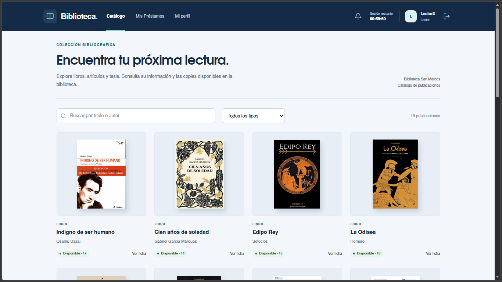
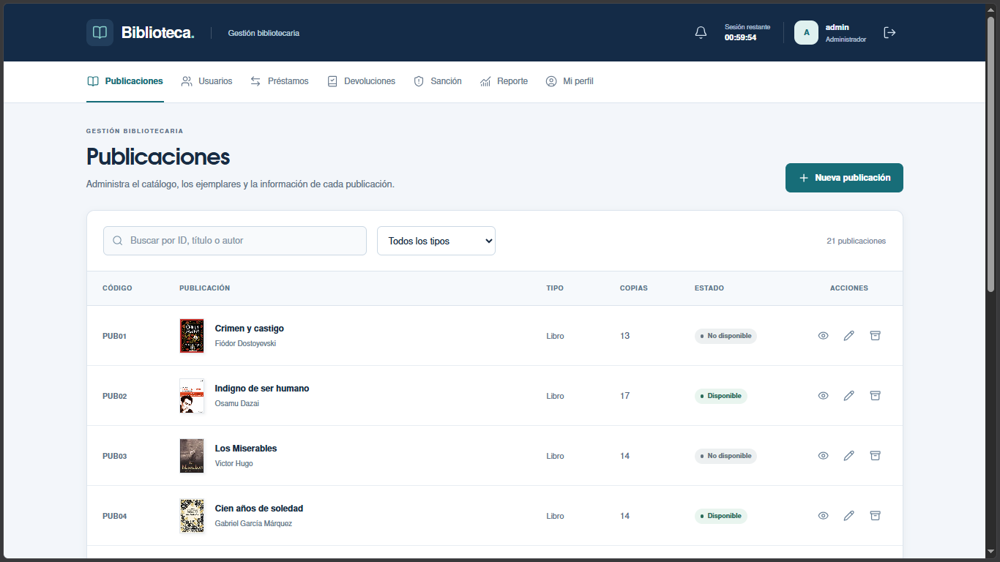
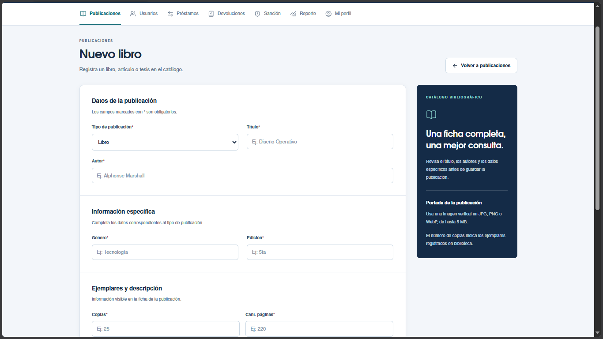
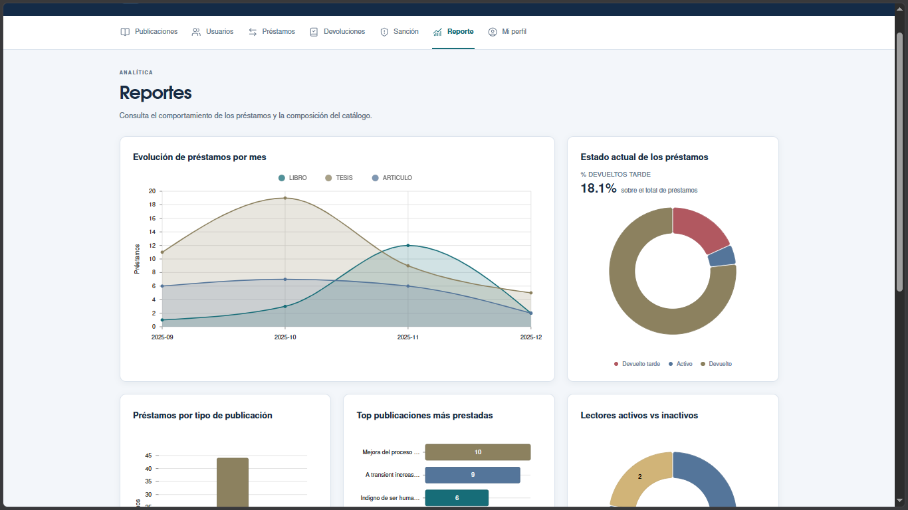

# Biblioteca San Marcos

Aplicación web para gestionar el catálogo, usuarios, préstamos, devoluciones y sanciones de una biblioteca. Cuenta con acceso para administradores, bibliotecarios y lectores, además de notificaciones, reportes y consulta del historial de préstamos.

## Vista previa

### Catálogo del lector



<details>
<summary>Ver más pantallas</summary>

### Inicio de sesión


### Gestión de publicaciones


### Registro de publicaciones


### Reportes


</details>

## Tecnologías

- **Backend:** Java 21, Spring Boot, Spring WebFlux, Spring Security, JWT y R2DBC.
- **Frontend:** React, Vite, Redux Toolkit, React Router, Tailwind CSS y Lucide React.
- **Base de datos:** PostgreSQL.
- **Gestores:** Maven Wrapper y pnpm.

## Requisitos

- Java 21.
- PostgreSQL con la estructura y funciones requeridas por la aplicación.
- Node.js 22.13 o superior.
- pnpm 11.25.0.

El repositorio no incluye scripts SQL de inicialización ni credenciales de demostración.

## Ejecución local

### Backend

Copia `.env.example` a `.env` dentro de `Biblioteca - back/` y configura la conexión a PostgreSQL y la clave JWT.

En Windows:

```powershell
cd "Biblioteca - back"
.\mvnw.cmd spring-boot:run
```

En Linux o macOS, utiliza `./mvnw spring-boot:run`.

La API se inicia en `http://localhost:8080`.

### Frontend

Copia `.env.example` a `.env` dentro de `Biblioteca - front/`. La configuración incluida apunta al backend local.

Desde otra terminal:

```bash
cd "Biblioteca - front"
pnpm install --frozen-lockfile
pnpm run dev
```

Abre `http://localhost:5173` e ingresa con una cuenta existente.

## Comandos del frontend

| Comando | Descripción |
| --- | --- |
| `pnpm run dev` | Iniciar el entorno de desarrollo. |
| `pnpm check` | Ejecutar ESLint y compilar el proyecto. |
| `pnpm build` | Generar la compilación de producción. |
| `pnpm preview` | Revisar la compilación localmente. |